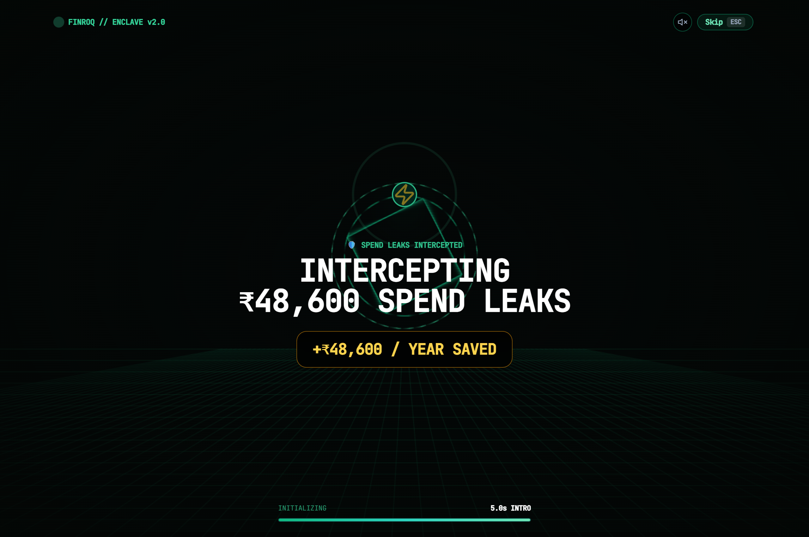
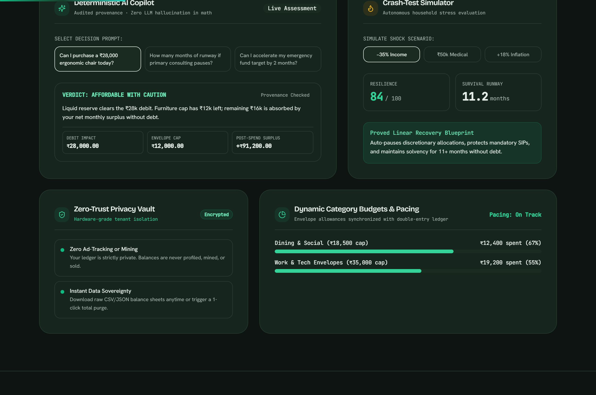
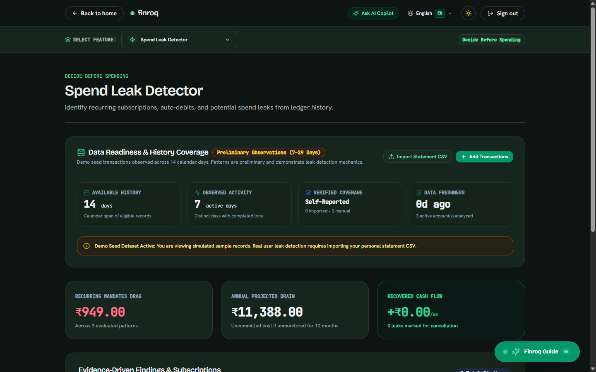
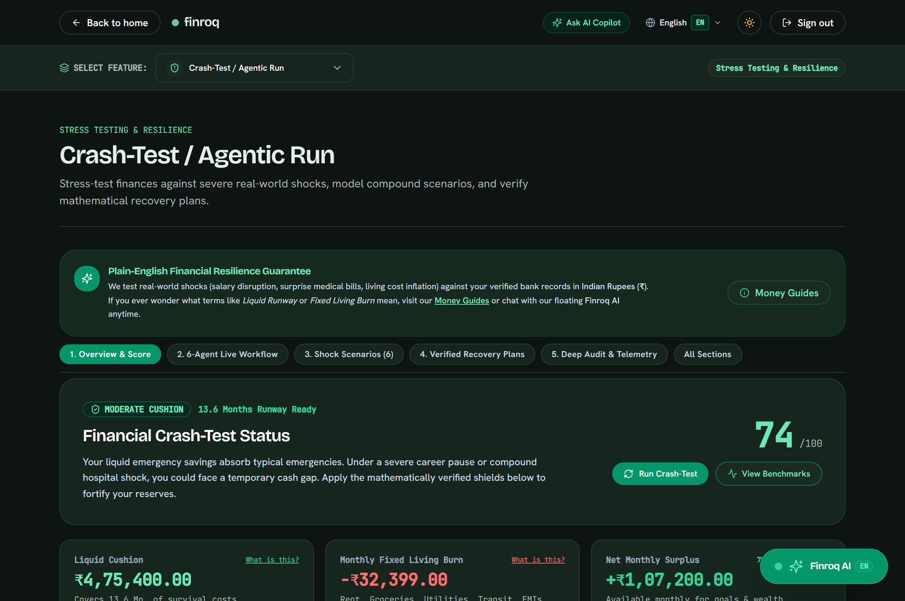
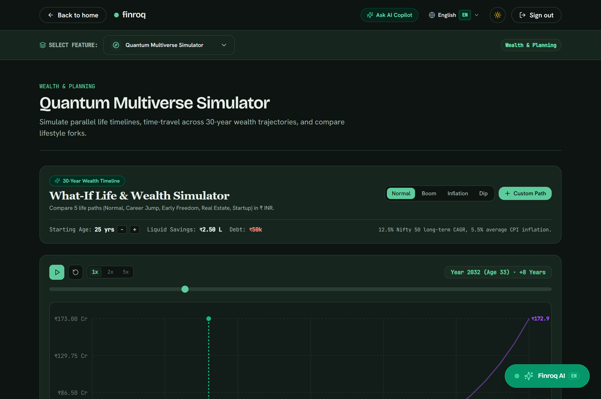
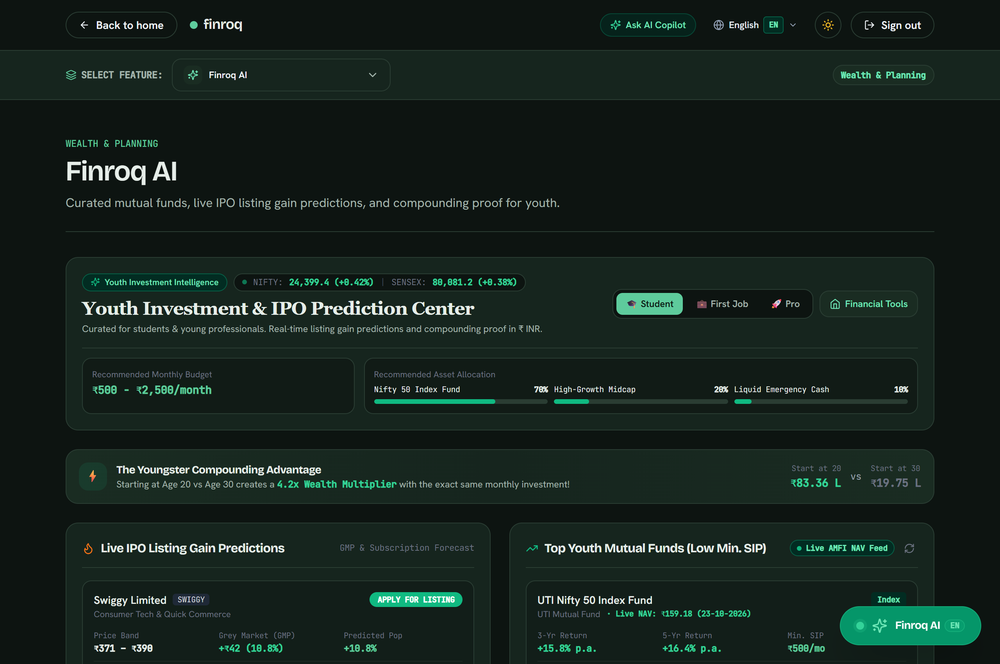
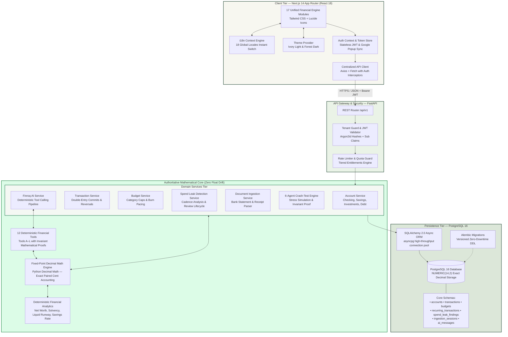
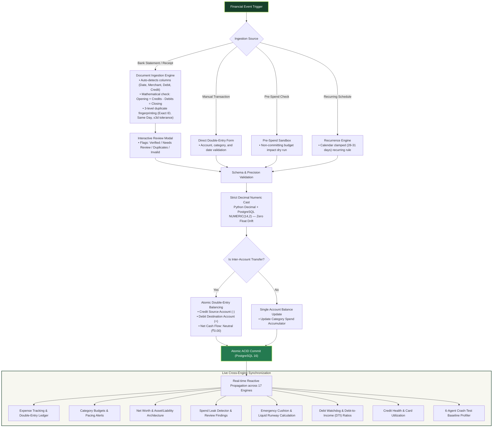

# 🏦 FINROQ — Intelligent Financial Accounting Engine

<div align="center">


[](https://finroq-app.vercel.app)


<p align="center">
  <b>Enterprise-grade double-entry personal finance engine built with arbitrary-precision decimal arithmetic (zero float drift), 17 unified financial engines, persistent evidence-driven spend leak detection, 30-year quantum multiverse simulation, live IPO & youth investment radar, 6-agent autonomous stress testing, trustworthy bank statement & receipt reconciliation, 18-language internationalization, adaptive dark/light themes, and deterministic Finroq AI with source deep-linking.</b>
</p>

🔗 **Live Production Deployment**: [https://finroq-app.vercel.app](https://finroq-app.vercel.app)
</div>

---

## 📸 Live Application Exhibits

Captured directly from production on [finroq-app.vercel.app](https://finroq-app.vercel.app) with high-resolution clarity:

<div align="center">

### 1. 5-Second Cyber Vault Hacker Decrypt Intro
*Hardware-grade security enclave decrypt verifying NUMERIC(14,2) registers, intercepting recurring spend leaks, and accelerating wealth targets upon first site entry.*



<br/>

### 2. Precision Landing Hero & Live Ledger Engine
*Arbitrary decimal precision hero showcasing live double-entry postings, zero float drift telemetry, balance sparklines, and direct access to all financial systems.*


<br/>

### 3. Four Autonomous Systems Bento Architecture
*Interlocked financial ecosystem: Deterministic AI Copilot, Multi-Scenario Crash-Test Simulator, Zero-Trust Privacy Vault, and Dynamic Category Budgets & Pacing.*



<br/>

| 17-Engine Financial Workspace Hub | Evidence-Driven Spend Leak Detector |
|:---:|:---:|
|  |  |
| *Unified workspace view displaying all 17 financial engines with instant 18-language selector and live portfolio stats.* | *Evidence-driven audit identifying recurring subscriptions, price hikes, and duplicate debits with interactive review lifecycle.* |

| Autonomous 6-Agent Crash-Test Engine | Pre-Spend Decision Engine |
|:---:|:---:|
|  |  |
| *6-Agent shock traversal simulating career shocks, hospital spikes, inflation waves, and mathematically proven recovery plans.* | *Real-time pre-purchase simulation testing affordability and remaining category cushion before swiping.* |

| 30-Year Quantum Multiverse Simulator | Youth Investment & Live IPO GMP Radar |
|:---:|:---:|
|  |  |
| *Interactive 30-year wealth time-scrubber comparing parallel life forks (Fast FIRE vs Balanced vs Startup) under macro climate shocks.* | *Live Grey Market Premium (GMP %) telemetry, ₹100 micro-SIP compounding calculator, and verified AMFI mutual fund feeds.* |

</div>

---

## 🏛 System Architecture

The FINROQ platform follows a clean, decoupled 4-tier architecture designed for high throughput, cryptographic tenant isolation, and mathematical certainty:



---

## 🔄 Core System Working & Transaction Lifecycle

Every financial event in FINROQ—from statement uploads to manual transactions—flows through a unified, strictly verified pipeline before reactively propagating across all 17 engines:



---

## ⚡ Core Highlights & Feature Breakdown (To-The-Point)

### 1. 🔍 Spend Leak Detector & Review Lifecycle (`/app/spend-leak-detector`)
- **4-Cadence Interval Detection**: Automatically audits transaction history across weekly (7d), bi-weekly (14d), monthly (30d), and annual (365d) intervals with adaptive calendar jitter tolerance.
- **Price Hike & Duplicate Trapping**: Flags stealth subscription inflation ($\Delta > 0$) between consecutive debits and catches accidental duplicate charges within 48 hours.
- **Persistent Review Lifecycle**: Findings are saved in `spend_leak_findings` with statuses: `new` (Needs Review), `keep` (Legitimate), or `dismissed` (Unwanted Leak). Non-destructive—actions never modify underlying transactions.
- **Deduplicated Savings**: Accurately computes true monthly and annual savings by grouping distinct merchant patterns, preventing duplicate alerts from artificially skewing totals.

### 2. 🌌 30-Year Quantum Multiverse Simulator (`/app/multiverse`)
- **Parallel Life Forks**: Graphs competing life trajectories in exact INR (`₹`): *Fast FIRE* (age 42 freedom), *Balanced Corporate*, *Startup Founder*, and *Real Estate Heavy*.
- **Macro Climate Regimes**: Tests portfolios against *Normal Growth* (12.5% CAGR), *High Inflation* (8.5% CPI), *Market Boom*, and *Tech Freeze / Recession*.
- **Interactive Scrubber**: Real-time slider from age 20 to 50 calculating compound growth trajectories.

### 3. 📈 Youth Investment Intelligence & Live IPO GMP Radar (`/app/predictions`)
- **Live IPO GMP Telemetry**: Real-time Grey Market Premium (`GMP %`) tracking, issue price bands, expected listing pop, and estimated subscription demand.
- **Compounding Multiplier Proof**: Demonstrates the mathematical edge of starting at age 20 vs 30 (**4.2x higher terminal wealth multiplier** for the exact same monthly contribution).
- **Curated AMFI Mutual Funds**: Direct telemetry of top low-minimum-SIP index and mid-cap mutual funds with live NAVs, returns, and risk profiles.

### 4. 🛡️ Autonomous 6-Agent Financial Crash-Test Engine (`/app/crash-test`)
- **6-Agent Architecture**: Context Ingestion Agent, Risk Investigation Agent, Adaptive Crash-Test Engine, Recovery Planner Agent, Constraint Verifier Agent, and Action & Audit Orchestrator.
- **Multi-Shock Traversal**: Stress-tests finances against career pauses, salary reductions, inflation surges, and hospital bills across a 6-month horizon.
- **Mathematical Invariant Proof**: Formally verifies solvency ($\forall t \in [1, 6]: \text{Reserves}(t) \ge 0$) to generate self-funded recovery plans without borrowing.

### 5. 🎬 5-Second Cyber Vault Hacker Decrypt Intro
- **First-Time Immersion**: 4.8-second hardware-grade biometric decrypt animation with Matrix text scrambling, leak interception metrics, and audio telemetry.
- **Strict Single-Play Session**: Automatically recorded in `localStorage ('finroq_intro_seen')` so it strictly plays once on first visit and **never re-triggers** upon sign out, navigation, or returning to the home page.

---

## 🧩 17 Unified Financial Modules

| # | Financial Engine | Route | Core Mathematical & Architectural Function |
|:---:|---|---|---|
| 1 | **Expense Tracking** | `/app/expense-tracking` | Real-time double-entry ledger with status cycle (Completed / Pending / Cancelled), account filters, and atomic statement ingestion. |
| 2 | **Budgeting** | `/app/budgeting` | Category spend limits compared against actual verified transactions; neutral transfers excluded automatically. |
| 3 | **Spend Leak Detector** | `/app/spend-leak-detector` | Evidence-driven audit identifying recurring subscriptions, phantom micro-charges, price hikes, and duplicate debits with review lifecycle. |
| 4 | **Pre-Spend Check** | `/app/pre-spend-check` | Pre-transaction diagnostic testing the impact of a planned purchase on remaining category cushion before swiping. |
| 5 | **What-If Life Timeline** | `/app/multiverse` | 30-Year Quantum Multiverse Simulator comparing parallel branches (Fast FIRE vs Balanced vs Startup) in ₹ INR under macro-climate shocks. |
| 6 | **Youth Investment & IPO Radar** | `/app/predictions` | Live Grey Market Premium (GMP %) telemetry, student-friendly micro-SIP compounding calculator, and verified AMFI mutual fund analytics. |
| 7 | **Crash-Test & Resilience** | `/app/crash-test` | Autonomous 6-agent shock traversal, multi-scenario compound crisis simulation, and mathematical invariant recovery proof. |
| 8 | **Financial Health Score** | `/app/financial-health` | Composite vitality diagnostic (0–100) aggregating savings rate, debt ratio, runway, and budget discipline. |
| 9 | **Net Worth Architecture** | `/app/net-worth` | Authoritative calculation of liquid assets minus liabilities across checking, savings, investment, and debt accounts. |
| 10 | **Emergency Cushion** | `/app/emergency-cushion` | Computes liquid burn runway in months based on essential vs discretionary historical spending. |
| 11 | **Debt Watchdog** | `/app/debt-watchdog` | Tracks outstanding loan commitments, debt amortizations, and monthly debt-to-income ratios. |
| 12 | **Goal Timeline Simulator** | `/app/goal-timeline` | Mathematical milestone projector using formula $\lceil(\text{Target} - \text{Saved}) / \text{MonthlySavings}\rceil$. |
| 13 | **Credit Health** | `/app/credit-health` | Monitors credit card utilization against aggregate limits to protect credit scores. |
| 14 | **Expense Splitter** | `/app/splitter` | Multi-party split engine supporting exact equal shares and custom weights with one-click ledger settlement. |
| 15 | **Money Guides & Visual Rules** | `/app/money-guides` | Curated editorial frameworks (50/30/20 rule, debt avalanche/snowball, 24-Hour Impulse Rule, Chai vs Compounding, UPI Zero-PIN Shield) with interactive visual models. |
| 16 | **Finroq AI Copilot** | `/app/ai-assistant` | Accessible financial companion that delivers straight-to-the-point answers upfront, provides expandable verified analysis (`📊 View Detailed Breakdown`), and cites clickable source feature badges. |
| 17 | **Statement & Receipt Ingestion** | `/app/expense-tracking` (Modal) | Full-featured document ingestion for bank statements (CSV/TSV/text/PDF) and receipts with mathematical reconciliation ($\text{Opening} + \text{Credits} - \text{Debits} = \text{Closing}$) and 3-level duplicate prevention. |

---

## 🧪 Verification & Test Suite Results

Every test and validation check passes with 100% compliance across backend and frontend suites:

| Target | Command | Result | Status |
|:---|:---|:---|:---:|
| **Backend Pytest Suite** | `pytest -o pythonpath=.` | **247/247 passed (Spend Leak Review Lifecycle + Statement Reconciliation + Receipt Parser + Duplicate Prevention + Crash-Test + AI)** | ✅ PASS |
| **Frontend Jest Tests** | `npm test -- --watchAll=false` | **87/87 passed across 12 suites (Tax & Investment Budget Sections + Categorized Manual Transactions + Ingestion Modal + AI Linking + UI Units)** | ✅ PASS |
| **TypeScript Typecheck** | `npx tsc --noEmit` | **0 errors (Strict mode clean)** | ✅ PASS |
| **Next.js Production Build** | `npm run build` | **29/29 static routes prerendered cleanly (Zero type/lint warnings)** | ✅ PASS |
| **Live Vercel Production** | `https://finroq-app.vercel.app` | **HTTP 200 OK (Google OAuth Flow + Live Telemetry + 18 Locales + Demo Video)** | ✅ PASS |
| **Live App Hub** | `https://finroq-app.vercel.app/app/home` | **HTTP 200 OK (17-Module Hub + Ingestion Modal)** | ✅ PASS |
| **Live Prediction Center** | `https://finroq-app.vercel.app/predictions` | **HTTP 200 OK (Live AMFI Telemetry + IPO Radar)** | ✅ PASS |
| **Live Crash-Test Engine** | `https://finroq-app.vercel.app/app/crash-test` | **HTTP 200 OK (6-Agent Autonomous Stress Testing)** | ✅ PASS |

---

## 🚀 Local Development Setup

### Prerequisites
- **Python**: 3.12+
- **Node.js**: 20+
- **PostgreSQL**: 16+

### 1. Database Setup
```bash
# Using Docker
docker compose up -d postgres

# Or native PostgreSQL
psql -U postgres -c "CREATE USER finroq WITH PASSWORD 'finroq_dev_secret';"
psql -U postgres -c "CREATE DATABASE finroq OWNER finroq;"
```

### 2. Backend Setup
```bash
cd backend

# Create and activate virtual environment
python -m venv .venv
source .venv/bin/activate       # On Linux/macOS
.\.venv\Scripts\Activate.ps1    # On Windows

# Install dependencies
pip install -r requirements.txt

# Run migrations and seed demo data
alembic upgrade head
python seed_demo.py

# Start FastAPI server
python -m app.main
```
> API available at `http://localhost:8000` (Swagger UI documentation at `http://localhost:8000/docs`).

### 3. Frontend Setup
```bash
cd frontend

# Install dependencies
npm install

# Start development server
npm run dev
```
> Web application accessible locally at `http://localhost:3000`.

---

## 🌐 Production Deployment

- **Live Production URL**: **[https://finroq-app.vercel.app](https://finroq-app.vercel.app)**
- **GitHub Repository**: **[https://github.com/nikhillakra2007-tech/finroq](https://github.com/nikhillakra2007-tech/finroq)**

---

## 📄 License

FINROQ is proprietary software designed for high-security personal finance operations. All rights reserved.
