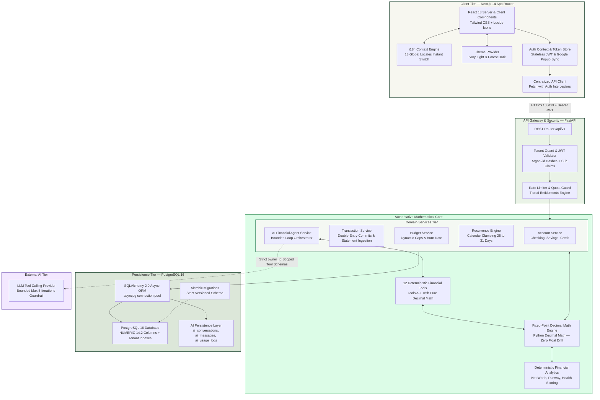
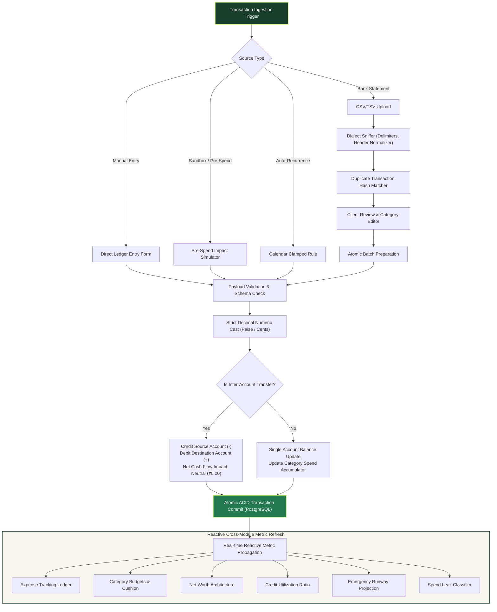

```mermaid
flowchart TD
    subgraph LEDGER["Authoritative PostgreSQL Core (₹ INR)"]
        DATA["Verified Accounts & Transactions<br/>Checking: ₹1.85L • Emergency Cushion: ₹4.75L<br/>Monthly Inflow: ₹1.50L • Fixed Burn: ₹28K/mo Rent + ₹8.5K EMI"]
    end

    subgraph AGENT1["Agent 1: Context Ingestion Agent"]
        A1["Financial Context Profiler<br/>• Reconciles liquid reserves & essential living burn<br/>• Derives net cash flow & savings rate (63.0%)<br/>• Calculates liquid runway in months"]
    end

    subgraph AGENT2["Agent 2: Risk Investigation Agent"]
        A2["Autonomous Fragility Hunter<br/>• Formulates 5 proactive vulnerability hypotheses<br/>• Tests rigidity index & discretionary cushion (₹14.8K/mo)<br/>• Uncovers compound sensitivity (96% confidence)"]
    end

    subgraph AGENT3["Agent 3: Adaptive Crash-Test Engine"]
        A3["Multi-Shock Traversal Simulator<br/>• Evaluates 6 severe stress scenarios over 6-month horizon<br/>• Career pause, salary reduction, inflation surge, hospital bills<br/>• Models compound dual crises and pinpoints cash gap month"]
    end

    subgraph AGENT4["Agent 4: Recovery Planner Agent"]
        A4["Mathematical Budget Optimizer<br/>• Linear expenditure reallocation<br/>• Throttles flexible leisure spending to preserve liquidity<br/>• Conserves up to ₹1,08,000 cash across 6 months"]
    end

    subgraph AGENT5["Agent 5: Constraint Verifier Agent"]
        A5["Formal Invariant Proof Engine<br/>• Proves: ∀ t ∈ [1, H]: Reserves(t) ≥ 0<br/>• Verifies solvency margins & credit covenant limits<br/>• Mathematical guarantee: 100% feasibility, zero hallucinations"]
    end

    subgraph AGENT6["Agent 6: Action & Audit Orchestrator"]
        A6["Plain-English Delivery & Execution<br/>• Ranks actionable shields with confidence metrics<br/>• 1-Click user approval & score boost (+26 pts)<br/>• Telemetry audit trail & performance benchmarks"]
    end

    DATA -- "Verified Ledger History" --> A1
    A1 -- "Net Cash Flow & Liquid Runway" --> A2
    A2 -- "Stress Hypotheses & Rigid Commitments" --> A3
    A3 -- "6-Month Cash Gap Trajectories" --> A4
    A4 -- "Candidate Recovery Shields" --> A5
    A5 -- "Mathematically Proven Plans" --> A6

    style LEDGER fill:#DCFCE7,stroke:#15803D,stroke-width:2px;
    style AGENT1 fill:#EAF3E7,stroke:#173F2B,stroke-width:2px;
    style AGENT2 fill:#F4F8F3,stroke:#247A50,stroke-width:2px;
    style AGENT3 fill:#FEF3C7,stroke:#B45309,stroke-width:2px;
    style AGENT4 fill:#E0E7FF,stroke:#3730A3,stroke-width:2px;
    style AGENT5 fill:#DCFCE7,stroke:#166534,stroke-width:2px;
    style AGENT6 fill:#F7F7F0,stroke:#173F2B,stroke-width:2px;
```

# 🏦 FINROQ — Intelligent Financial Accounting Engine

<div align="center">


[](https://finroq-app.vercel.app)


<p align="center">
  <b>Enterprise-grade double-entry personal finance engine with arbitrary-precision decimal arithmetic, trustworthy bank statement & receipt ingestion with mathematical reconciliation, 13 unified financial modules, 6-agent autonomous financial crash-testing, fully reactive 18-language internationalization across the landing page and app, Google popup authentication, adaptive dark/light themes, and Simplistic Finroq AI with expandable detailed analysis, voice recognition, and clickable source feature deep-linking.</b>
</p>

🔗 **Live Production Deployment on Vercel**: [https://finroq-app.vercel.app](https://finroq-app.vercel.app)  
</div>

---

## 📸 Live Application Exhibits

Captured directly from production on [finroq-app.vercel.app](https://finroq-app.vercel.app) with borderless high-resolution clarity:

<div align="center">

### Cinematic Engine Telemetry Boot Sequence
*Autonomous hardware-grade system calibration verifying NUMERIC(14,2) registers, purging float drift, and securing Argon2id enclaves upon entry.*


<br/>

### Precision Landing Hero & Live Ledger Engine
*Arbitrary decimal precision hero showcasing live double-entry postings, zero float drift telemetry, balance sparklines, and interactive telemetry replay controls.*


<br/>

### Four Autonomous Systems Bento Architecture
*Interlocked financial ecosystem: Deterministic AI Copilot, Multi-Scenario Crash-Test Simulator, Zero-Trust Privacy Vault, and Dynamic Category Budgets & Pacing.*


<br/>

| Autonomous 6-Agent Crash-Test Engine | Evidence-Driven Spend Leak Detector |
|:---:|:---:|
|  |  |
| *6-Agent shock traversal simulating career shocks, hospital spikes, and cost-of-living crunches.* | *Evidence-driven audit identifying recurring subscriptions, micro-charges, and irregular surges.* |

| 13-Module Unified Financial Workspace Hub | Pre-Spend Decision Engine |
|:---:|:---:|
|  |  |
| *Unified workspace view displaying all 13 financial engines with instant 18-language selector.* | *Real-time pre-purchase simulation on remaining budget caps.* |

</div>

---

## 🌟 Core Architectural Pillars

- ⚖️ **Arbitrary-Precision Decimal Arithmetic**: Powered by Python `Decimal` and database `NUMERIC(14, 2)`. Completely eliminates IEEE 754 floating-point drift across currency conversions, allocations, and ledger entries.
- 🎨 **Adaptive Ivory & Forest Theming**: Warm Ivory (`#F7F7F0`) light mode with deep contrast typography and deep forest (`#0D1411`) dark mode with zero-FOUC pre-hydration scripts and system-preference detection.
- 🌍 **Fully Reactive 18-Language Internationalization**: Complete dynamic translation coverage for 18 global languages across both the public landing page (Hero, Terminal, Bento Grid, Solvency Simulator, Matrix, Trust, FAQs, and Finale CTA) and the in-app workspaces (English, Hindi, Bengali, Gujarati, Marathi, Tamil, Telugu, Kannada, Spanish, French, German, Mandarin, Japanese, Arabic, Russian, Portuguese, Korean, Italian).
- 🤖 **Simplistic Finroq AI with Source Deep-Linking**: Accessible financial companion that delivers straight-to-the-point answers upfront, provides expandable verified analysis (`📊 View Detailed Breakdown`) on demand, and cites clickable source feature badges (`📌 Source: [Feature Name](/app/...)`) that navigate users directly to that tool.
- 🔐 **Google Popup Authentication**: Modern popup-based Google OAuth flow (`/auth/google-popup`) with multi-channel cross-window communication (`window.postMessage`, storage dispatch, fallback sync) and persistent AuthContext state.
- 🔄 **Unified Decimal Ledger Model**: Single authoritative source of truth. All 13 modules read completed transactions, live accounts, and net-worth metrics directly from the shared financial core.
- 📥 **Trustworthy Bank Statement & Receipt Ingestion**: Comprehensive processing for CSV, TSV, text, and text-based PDF bank statements with automated mathematical reconciliation ($\text{Opening} + \text{Credits} - \text{Debits} = \text{Closing}$) and transparent discrepancy diagnostics. Ingests shopping receipts and invoices with subtotal, tax/GST, discount, and line-item extraction. Protects ledger integrity through 3-level cross-source duplicate prevention and field confidence states (`Verified`, `Pending Review`, `Potential Match`, `Invalid Amount`) with zero silent commits.
- 🛡️ **Zero-Hallucination Safe AI Pipeline**: Strict 3-layer architecture where authoritative numbers are deterministically computed in Python before any context reaches Google Gemini or OpenAI.

---

## 📥 Trustworthy Bank Statement & Receipt Ingestion System

FINROQ now includes an enterprise-grade document ingestion pipeline designed to make importing financial documents effortless, transparent, and mathematically foolproof.

### 🌟 What This System Does (In Simple Terms)

1. **📄 Upload Any Bank Statement**:
   - Supports CSV, TSV, plain text, and text-based PDF statements from all major banks.
   - Automatically detects columns for Date, Description, Debit, Credit, and Running Balance.

2. **🧾 Upload Shopping Bills & Receipts**:
   - Ingests grocery bills, restaurant receipts, and utility invoices.
   - Intelligently extracts the Merchant Name, Date, Subtotal, Taxes (GST/VAT), Discounts, and Total Amount.

3. **🧮 Automatic Mathematical Reconciliation**:
   - For bank statements, the engine computes:  
     $$\text{Opening Balance} + \text{Total Credits} - \text{Total Debits} = \text{Expected Closing Balance}$$
   - If the statement does not balance, FINROQ highlights the exact difference instead of silently corrupting your ledger.

4. **🔍 Interactive Review Screen Before Anything Is Saved**:
   - Transactions are never imported blindly. You get a clean preview modal with tabs for **All Transactions**, **Needs Review**, and **Duplicates**.
   - Clear confidence indicators:
     - 🟢 **Verified**: Clean, high-confidence match.
     - 🟡 **Pending Review**: Missing category or low confidence description that you can edit with one click.
     - 🔴 **Potential Match**: Warning for transactions that already exist in your ledger.
     - ⚠️ **Invalid Amount**: Zero or corrupt values flagged for correction.

5. **🚫 3-Level Duplicate Protection**:
   - **Level 1 (Exact ID)**: Catches duplicate bank transaction reference numbers.
   - **Level 2 (Fingerprint)**: Catches same account + same date + same amount + similar merchant.
   - **Level 3 (Cross-Source Tolerance)**: Matches paper receipts against existing bank or card charges within ±3 days.

6. **⚡ 1-Click Atomic Ledger Import**:
   - Once you confirm, all selected transactions are posted with exact decimal precision directly to your chosen account, instantly updating your budgets, net worth, and financial health score.


---

## 🏛 System Architecture

The FINROQ platform follows a clean, decoupled 4-tier architecture designed for high throughput, cryptographic tenant isolation, and mathematical certainty:



---

## 🛡️ Autonomous 6-Agent Financial Crash-Test Engine

The **Crash-Test Engine** (`/app/crash-test`) is an interconnected 6-agent system that stress-tests a user's verified financial baseline against severe real-world shocks, identifies hidden fragility, and generates mathematically proven recovery plans without taking on high-cost debt.



### The 6 Logical Agents Explained

| # | Agent Name | Architecture & Core Responsibilities | Mathematical Tooling & Guardrails |
|:---:|---|---|---|
| 1 | **Context Ingestion Agent** | Reconciles checking, savings, payroll, and debt commitments in INR (`₹`) into an immutable snapshot. | `account_balance()`, `fixed_burn()`, `liquid_runway = accessible_cash / fixed_monthly_expenses`. |
| 2 | **Risk Investigation Agent** | Autonomously formulates and tests structural cash-flow hypotheses without prompt assistance. | `rigidity_index()`, `discretionary_buffer_levers()`, multi-shock sensitivity matrix. |
| 3 | **Crash-Test Simulation Engine** | Traverses 6 multi-scenario shock graphs across a 6-month horizon to pinpoint deficit months. | Deterministic monthly balance trajectory: $B_t = B_{t-1} + \Delta\text{Inflow}_t - \Delta\text{Outflow}_t$. |
| 4 | **Recovery Planner Agent** | Formulates self-funded budget recovery paths by throttling flexible spending instead of borrowing. | Linear budget reallocation, discretionary pause pacing, emergency cushion preservation. |
| 5 | **Constraint Verifier Agent** | Rigorously proves non-negativity across all shock months, eliminating AI hallucinations. | Invariant validation: $\forall t \in [1, 6]: \text{Reserves}(t) \ge 0$, debt covenant checking. |
| 6 | **Action & Audit Orchestrator** | Synthesizes verified math into plain-English advice and 1-click user authorization hooks. | Priority rank matrix, 1-click ledger execution, benchmark telemetry reporting. |

---

## 🔄 Financial Accounting Lifecycle & Data Pipeline

Every transaction, whether manually entered, imported from a bank statement, or simulated via the Pre-Spend sandbox, traverses a deterministic processing pipeline:



---

## 🤖 Simplistic Finroq AI: Direct Answers with Deep Breakdown & Feature Linking

Finroq AI is engineered to eliminate financial overwhelm. Instead of burying users in long walls of generic advice or floating-point approximations, it operates under three fundamental UX rules:

1. **To-The-Point Simplistic Summary**:
   - Every answer begins with a concise, crystal-clear 1–2 sentence direct verdict or summary.
   - For budget inquiries, spend diagnostics, or affordability checks, users get their bottom-line figure immediately.
2. **Expandable Detailed Analysis (`📊 View Detailed Breakdown`)**:
   - Deeper calculations, category itemizations, math steps, and buffer metrics are neatly tucked behind an interactive toggle.
   - Users who want everyday simplicity see just the essential verdict, while power users and engineers can expand the full analytical ledger breakdown on demand.
3. **Interactive Source Feature Deep-Linking**:
   - Whenever Finroq AI provides guidance, it explicitly attributes the exact engine powering that conclusion (e.g. `📌 Source: Daily Budgeting`).
   - Citing features as interactive badges lets users jump directly to that engine in the live app (`/app/budgeting`, `/app/expense-tracking`, `/app/crash-test`, `/app/pre-spend-check`, etc.) with a single click.
4. **Complete 18-Language & Speech Parity**:
   - Full support for English, Hindi, Bengali, Gujarati, Marathi, Tamil, Telugu, Kannada, Spanish, French, German, Mandarin, Japanese, Arabic, Russian, Portuguese, Korean, and Italian with voice speech recognition in every native locale.

---

## 🧩 13 Unified Financial Modules

| # | Financial Engine | Route | Core Mathematical & Architectural Function |
|:---:|---|---|---|
| 1 | **Expense Tracking** | `/app/expense-tracking` | Real-time double-entry ledger with status cycle (Completed / Pending / Cancelled), account filters, and atomic statement ingestion. |
| 2 | **Daily Budgeting** | `/app/budgeting` | Category spend limits compared against actual verified transactions; neutral transfers excluded automatically. |
| 3 | **Expense Splitter** | `/app/splitter` | Multi-party split engine supporting exact equal shares and custom weights with one-click ledger settlement. |
| 4 | **Pre-Spend Check** | `/app/pre-spend-check` | Pre-transaction diagnostic testing the impact of a planned purchase on remaining category cushion before swiping. |
| 5 | **Net Worth** | `/app/net-worth` | Authoritative calculation of liquid assets minus liabilities across checking, savings, investment, and debt accounts. |
| 6 | **Debt Watchdog** | `/app/debt-watchdog` | Tracks outstanding loan commitments, debt amortizations, and monthly debt-to-income ratios. |
| 7 | **Spend Leak Detector** | `/app/spend-leak-detector` | Evidence-driven audit identifying recurring subscriptions, phantom micro-charges, and irregular spend surges. |
| 8 | **Goal Timeline Simulator** | `/app/goal-timeline` | Mathematical milestone projector using formula `ceil((Target - Saved) / MonthlySavings)`. |
| 9 | **Emergency Cushion** | `/app/emergency-cushion` | Computes liquid burn runway in months based on essential vs discretionary historical spending. |
| 10 | **Money Guides** | `/app/money-guides` | Curated editorial frameworks (50/30/20 rule, debt avalanche/snowball, liquidity buffers, crash-test terminologies) with visual models. |
| 11 | **Credit Health** | `/app/credit-health` | Monitors credit card utilization against aggregate limits to protect credit scores. |
| 12 | **Financial Health Score** | `/app/financial-health` | Composite vitality diagnostic (0–100) aggregating savings rate, debt ratio, runway, and budget discipline. |
| 13 | **Crash-Test & Resilience** | `/app/crash-test` | Autonomous 6-agent shock traversal, multi-scenario compound crisis simulation, and mathematical invariant recovery proof. |

---

## 🧪 Verification & Test Suite Results

Every test and validation check passes with 100% compliance:

| Target | Command | Result | Status |
|:---|:---|:---|:---:|
| **Backend Pytest Suite** | `pytest -o pythonpath=.` | **236/236 passed (Ingestion Engine + Statement Reconciliation + Receipt Parser + Duplicate Prevention + Crash-Test + AI)** | ✅ PASS |
| **Frontend Jest Tests** | `npm test -- --watchAll=false` | **81/81 passed across 10 suites (Statement & Receipt Ingestion Modal + AI Linking + UI Units)** | ✅ PASS |
| **TypeScript Typecheck** | `npx tsc --noEmit` | **0 errors (Strict mode clean)** | ✅ PASS |
| **Next.js Production Build** | `npm run build` | **25/25 static routes prerendered cleanly** | ✅ PASS |
| **Live Vercel Production** | `https://finroq-app.vercel.app` | **HTTP 200 OK (Google Popup Auth + Voice Speech + 18 Locales)** | ✅ PASS |
| **Live App Hub** | `https://finroq-app.vercel.app/app/home` | **HTTP 200 OK (13-Module Hub + Ingestion Modal)** | ✅ PASS |
| **Live Crash-Test Engine** | `https://finroq-app.vercel.app/app/crash-test` | **HTTP 200 OK (6-Agent Autonomous Stress Testing)** | ✅ PASS |

---

## 🚀 Local Development Setup

### Prerequisites
- **Python**: 3.12+
- **Node.js**: 20+
- **PostgreSQL**: 16+

### 1. Database Setup
```bash
# Using Docker
docker compose up -d postgres

# Or native PostgreSQL
psql -U postgres -c "CREATE USER finroq WITH PASSWORD 'finroq_dev_secret';"
psql -U postgres -c "CREATE DATABASE finroq OWNER finroq;"
```

### 2. Backend Setup
```bash
cd backend

# Create and activate virtual environment
python -m venv .venv
source .venv/bin/activate       # On Linux/macOS
.\.venv\Scripts\Activate.ps1    # On Windows

# Install dependencies
pip install -r requirements.txt

# Run migrations and seed demo data
alembic upgrade head
python seed_demo.py

# Start FastAPI server
python -m app.main
```
> API available at `http://localhost:8000` (Swagger UI documentation at `http://localhost:8000/docs`).

### 3. Frontend Setup
```bash
cd frontend

# Install dependencies
npm install

# Start development server
npm run dev
```
> Web application accessible locally at `http://localhost:3000`.

---

## 🌐 Production Deployment

- **Primary Production URL**: **[https://finroq-app.vercel.app](https://finroq-app.vercel.app)**
- **Direct Workspace Hub**: **[https://finroq-app.vercel.app/app/home](https://finroq-app.vercel.app/app/home)**
- **Autonomous Crash-Test Engine**: **[https://finroq-app.vercel.app/app/crash-test](https://finroq-app.vercel.app/app/crash-test)**
- **GitHub Repository**: **[https://github.com/nikhillakra2007-tech/finroq](https://github.com/nikhillakra2007-tech/finroq)**

---

## 📄 License

FINROQ is proprietary software designed for high-security personal finance operations. All rights reserved.
