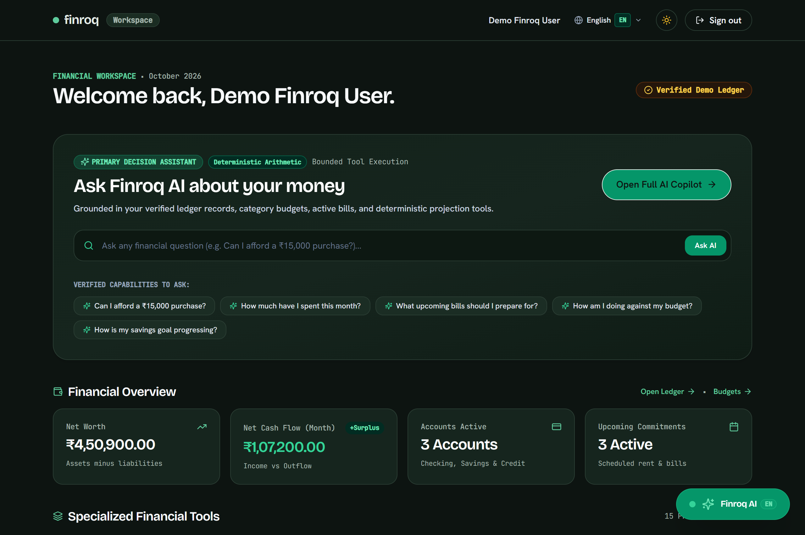
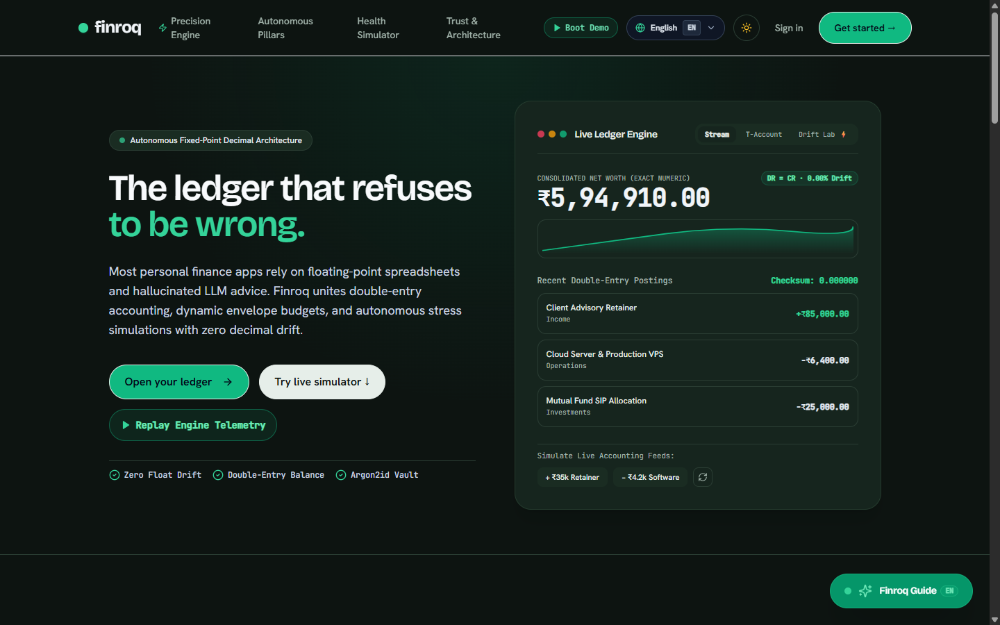
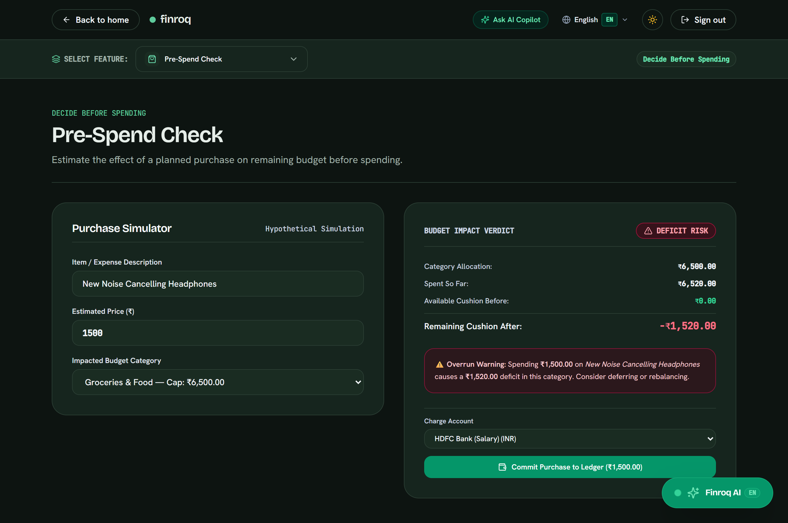
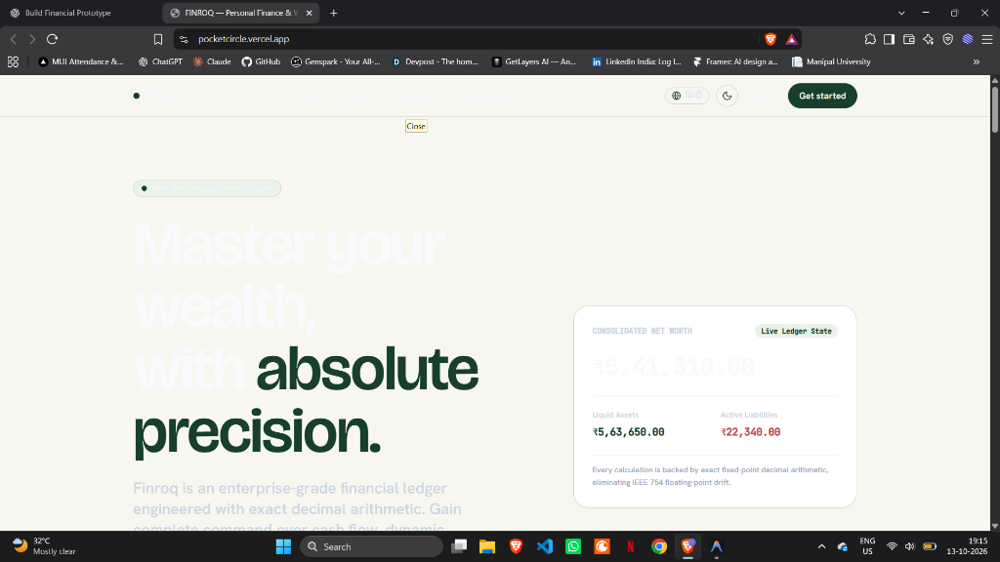
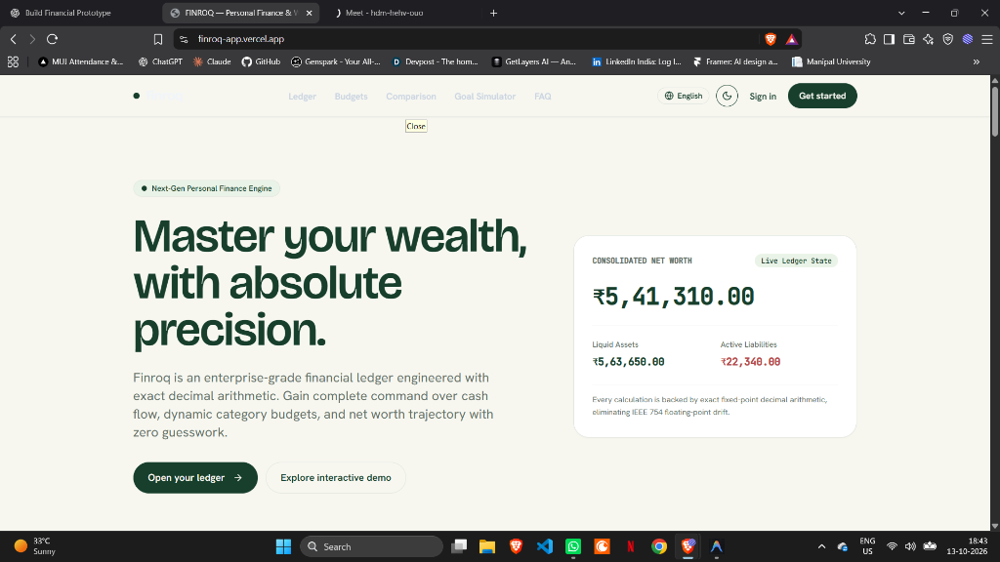
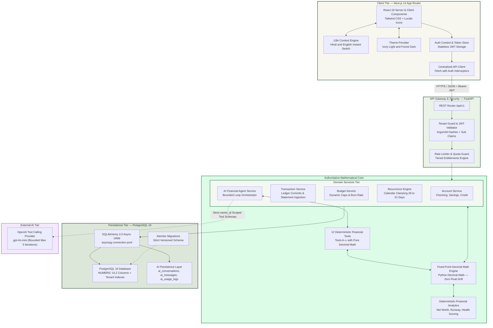
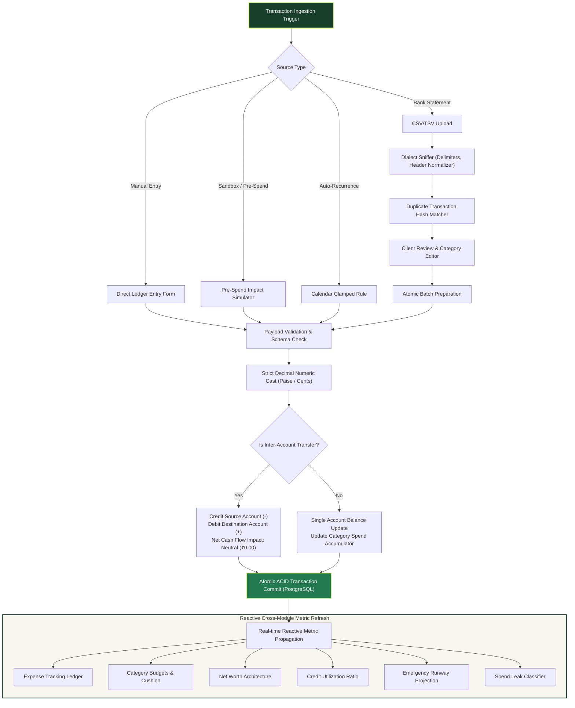
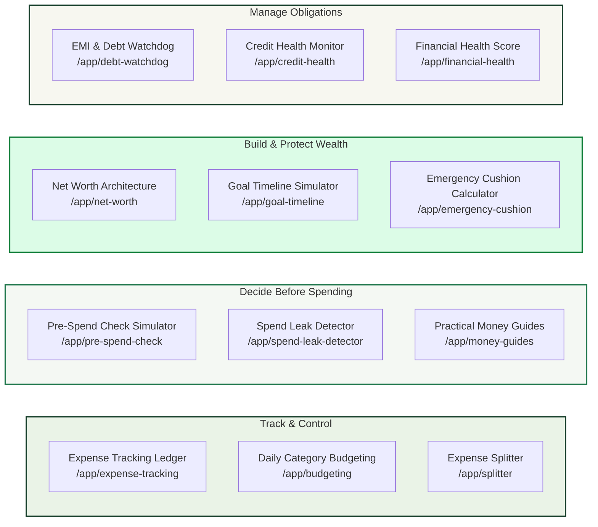
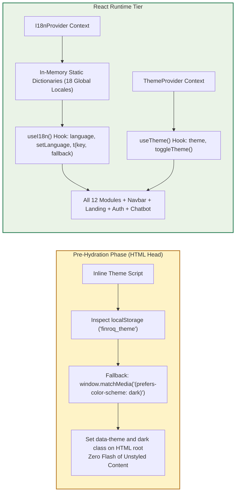

# 🏦 FINROQ — Intelligent Financial Accounting Engine

<div align="center">


[](https://finroq-app.vercel.app)


<p align="center">
  <b>Enterprise-grade double-entry personal finance engine with arbitrary-precision decimal arithmetic, 12 unified financial modules, 18-language internationalization, Google popup authentication, adaptive dark/light themes, bank statement ingestion, and Floating Finroq AI personal financial intelligence agent with voice recognition.</b>
</p>

🔗 **Live Production Deployment**: [https://finroq-app.vercel.app](https://finroq-app.vercel.app)  
🌐 **Alternative Production Mirrors**: [https://pocketcircle.vercel.app](https://pocketcircle.vercel.app) • [https://finroq-os.vercel.app](https://finroq-os.vercel.app)

[Live Application Exhibits](#-live-application-exhibits) •
[System Architecture](#-system-architecture) •
[Finroq AI Intelligence Agent](#-finroq-ai--personal-financial-intelligence-agent) •
[Financial Accounting Lifecycle](#-financial-accounting-lifecycle--data-pipeline) •
[12 Unified Financial Modules](#-12-unified-financial-modules) •
[18-Language i18n & Theming Engine](#-full-site-18-language-i18n--theming-engine) •
[Verification Matrix](#-verification--test-suite-results) •
[Quickstart](#-local-development-setup)

</div>

---

## 📸 Live Application Exhibits

High-resolution application captures taken directly from live production on [finroq-app.vercel.app](https://finroq-app.vercel.app):

<div align="center">

### 12-Module Unified Financial Workspace Hub
*Live workspace view displaying all 12 financial engines with instant 18-language selector, Google authentication, and floating AI assistant launcher.*



</div>

<br/>

<div align="center">

| Precision Landing Showcase | Pre-Spend Decision Engine |
|:---:|:---:|
|  |  |
| *Arbitrary decimal precision hero, 18-language switcher, and ledger verification.* | *Real-time pre-purchase simulation on remaining budget caps with localized impact cards.* |

| Credit Health Architecture | Autonomous Daily Budgeting |
|:---:|:---:|
|  |  |
| *Live credit utilization ratios and payment discipline.* | *Active category burn-rate monitoring and auto-rebalancing.* |

</div>

---

## 🌟 Executive Overview

**FINROQ** is an enterprise-class financial platform built with FastAPI, Next.js 14, and PostgreSQL 16. It replaces the error-prone assumptions and floating-point roundoff errors of consumer budget apps with strict mathematical accounting and zero-trust tenant security:

- ⚖️ **Arbitrary-Precision Decimal Arithmetic**: Powered by Python `Decimal` and database `NUMERIC(14, 2)`. Completely eliminates IEEE 754 floating-point drift across currency conversions, allocations, and ledger entries.
- 🎨 **Adaptive Ivory & Forest Theming**: Warm Ivory (`#F7F7F0`) light mode with deep contrast typography and deep forest (`#0D1411`) dark mode with zero-FOUC pre-hydration scripts and system-preference detection.
- 🌍 **Comprehensive 18-Language Internationalization**: Full prototype coverage for 18 global languages (English, Hindi, Spanish, French, German, Mandarin, Japanese, Russian, Arabic, Portuguese, Italian, Korean, Dutch, Turkish, Bengali, Telugu, Marathi, Tamil) with responsive typography protection that eliminates text overflow.
- 🔐 **Google Popup Authentication**: Modern popup-based Google OAuth flow (`/auth/google-popup`) with multi-channel cross-window communication (`window.postMessage`, storage dispatch, fallback sync) and persistent AuthContext state.
- 🤖 **Floating Finroq AI Financial Companion**: Non-intrusive floating launcher on the bottom-right corner of both landing and workspace pages with voice recognition and automatic response language adaptation.
- 🔄 **Unified Decimal Ledger Model**: Single authoritative source of truth. All 12 modules read completed transactions, live accounts, and net-worth metrics directly from the shared financial core.
- 📥 **Robust Bank Statement Ingestion**: Multi-format CSV/TSV dialect sniffer, duplicate detection, and interactive pre-commit review.
- 🛡️ **Zero-Hallucination Safe AI Pipeline**: Strict 3-layer architecture where authoritative numbers are deterministically computed in Python before any context reaches Google Gemini.

---

## 🏛 System Architecture

The FINROQ platform follows a clean, decoupled 4-tier architecture designed for high throughput, cryptographic tenant isolation, and mathematical certainty:



---

## 🤖 Finroq AI — Personal Financial Intelligence Agent

FINROQ incorporates an enterprise-grade financial intelligence agent designed for **deterministic certainty**, **zero numerical hallucinations**, and **frictionless multimodal interaction**:

```mermaid
flowchart LR
    subgraph INPUT["Client Interaction Tier"]
        VOICE["🎙️ Web Speech Voice Input<br/>SpeechRecognition API"]
        TYPE["⌨️ Natural Language Text<br/>Interactive Message Bar"]
        FLOAT_BTN["Floating Bottom-Right Logo<br/>fixed bottom-6 right-6"]
        
        FLOAT_BTN --> VOICE
        FLOAT_BTN --> TYPE
    end

    subgraph ORCHESTRATION["Backend Orchestration (FastAPI)"]
        CHAT_SVC["Chat Service /api/v1/ai/chat<br/>Conversation Lifecycle & Token Accounting"]
        BOUNDED_LOOP["Bounded Tool Calling Loop<br/>Enforced Max 5 Iterations Guardrail"]
        SECURITY_GUARD["Tenant Isolation Guard<br/>Strict owner_id Filter on all ORM queries"]
        
        VOICE --> CHAT_SVC
        TYPE --> CHAT_SVC
        CHAT_SVC --> SECURITY_GUARD
        SECURITY_GUARD --> BOUNDED_LOOP
    end

    subgraph TOOLS["12 Deterministic Financial Tools (A–L)"]
        T1["get_account_balances"]
        T2["get_cash_flow_summary"]
        T3["get_budget_status"]
        T4["get_recurring_commitments"]
        T5["get_net_worth"]
        T6["get_debt_and_liabilities"]
        T7["get_spending_breakdown"]
        T8["get_emergency_fund_runway"]
        T9["simulate_purchase_affordability"]
        T10["get_investment_allocation"]
        T11["get_goal_milestones"]
        T12["detect_spending_anomalies"]
        
        BOUNDED_LOOP <--> TOOLS
    end

    subgraph OUTPUT["Rich Structured Client Experience"]
        SYNTH["Plain-Text Advisory Synthesis"]
        CARDS["Structured Metric Cards<br/>Cash Flow, Budget Variance, Runway, Bills"]
        PERSIST["Conversation History DB<br/>ai_conversations, ai_messages"]
        
        BOUNDED_LOOP --> SYNTH
        BOUNDED_LOOP --> CARDS
        CHAT_SVC --> PERSIST
    end

    style INPUT fill:#F7F7F0,stroke:#173F2B,stroke-width:2px;
    style ORCHESTRATION fill:#EAF3E7,stroke:#247A50,stroke-width:2px;
    style TOOLS fill:#DCFCE7,stroke:#15803D,stroke-width:2px;
    style OUTPUT fill:#DCE7D9,stroke:#173F2B,stroke-width:2px;
```

### 1. The 12 Deterministic Financial Tools (A–L)

Every metric returned to the language model is executed deterministically against verified ledger rows using Python `Decimal` math quantized to `0.01`:

| Tool Letter | Function Name | Purpose & Arithmetic Specification |
|:---:|---|---|
| **A** | `get_account_balances` | Returns checking, savings, investment, and credit accounts with exact balances. |
| **B** | `get_cash_flow_summary` | Quantizes total income, total expense, and net surplus over custom timeframe; neutral transfers excluded. |
| **C** | `get_budget_status` | Category-by-category plan vs. actual spending, remaining cushion, and percentage utilized. |
| **D** | `get_recurring_commitments`| Active subscriptions, auto-debits, frequencies, next due dates, and projected 30-day burden. |
| **E** | `get_net_worth` | Total assets minus liabilities with full asset/liability breakdown. |
| **F** | `get_debt_and_liabilities` | Outstanding loan balances, minimum monthly obligations, and debt-to-income (DTI) ratio. |
| **G** | `get_spending_breakdown` | Category aggregates, percentage of total spend, and top merchant transactions. |
| **H** | `get_emergency_fund_runway` | Liquid cash reserves divided by monthly burn rate (`Runway = Liquid / MonthlyBurn`). |
| **I** | `simulate_purchase_affordability` | Pre-transaction check calculating post-purchase category balance, remaining cushion, and safe-to-spend verdict. |
| **J** | `get_investment_allocation` | Current asset distribution (equity, debt, gold, cash) compared against target allocations. |
| **K** | `get_goal_milestones` | Savings milestone trajectory and estimated completion months: `ceil((Target - Saved) / MonthlySavings)`. |
| **L** | `detect_spending_anomalies` | Audits recent charges against 90-day moving averages to flag duplicate bills and unexpected surges. |

### 2. Multi-Modal Interaction: Type & Speak
- **Floating Bottom-Right Trigger**: Available across all workspace pages (`fixed bottom-6 right-6 z-50`) as an unobtrusive glowing badge.
- **Web Speech API Voice Input**: Tap the microphone button (`🎙️`) to speak queries in English or Hindi. Real-time speech transcription renders directly into the input bar.
- **Zero Layout Disruption**: Leaves the classic 12-Module home launcher intact while giving instant access to conversational accounting.

### 3. Security, Guardrails & Bounded Tool Loops
- **Tenant Isolation**: Every database tool query explicitly joins or filters on `owner_id = current_user.id`. Impossible to leak cross-user ledger records.
- **Bounded Tool Calling**: Enforces an strict upper bound of **5 iterations** per conversational turn (`AI_MAX_TOOL_ITERATIONS = 5`) to prevent runaway API loops.
- **Conversation Persistence**: Full thread history stored across PostgreSQL tables `ai_conversations`, `ai_messages`, and `ai_usage_logs` with cascading deletes.

## 🔄 Financial Accounting Lifecycle & Data Pipeline

Every transaction, whether manually entered, imported from a bank statement, or simulated via the Pre-Spend sandbox, traverses a deterministic processing pipeline:



---

## 🧩 12 Unified Financial Modules

All modules are seamlessly integrated into the unified FINROQ navigation shell, sharing identical design language, responsive states, and dual Hindi/English localization:



| # | Financial Engine | Route | Core Mathematical & Architectural Function |
|:---:|---|---|---|
| 1 | **Expense Tracking** | `/app/expense-tracking` | Real-time double-entry ledger with status cycle (Completed / Pending / Cancelled), account filters, and atomic statement ingestion. |
| 2 | **Daily Budgeting** | `/app/budgeting` | Category spend limits compared against actual verified transactions; neutral transfers excluded automatically. |
| 3 | **Expense Splitter** | `/app/splitter` | Multi-party split engine supporting exact equal shares and custom weights with one-click ledger settlement. |
| 4 | **Pre-Spend Check** | `/app/pre-spend-check` | Pre-transaction diagnostic testing the impact of a planned purchase on remaining category cushion before swiping. |
| 5 | **Net Worth** | `/app/net-worth` | Authoritative calculation of liquid assets minus liabilities across checking, savings, investment, and debt accounts. |
| 6 | **Debt Watchdog** | `/app/debt-watchdog` | Tracks outstanding loan commitments, debt amortizations, and monthly debt-to-income ratios. |
| 7 | **Spend Leak Detector** | `/app/spend-leak-detector` | Evidence-driven audit identifying recurring subscriptions, phantom micro-charges, and irregular spend surges. |
| 8 | **Goal Timeline Simulator** | `/app/goal-timeline` | Mathematical milestone projector using formula `ceil((Target - Saved) / MonthlySavings)`. |
| 9 | **Emergency Cushion** | `/app/emergency-cushion` | Computes liquid burn runway in months based on essential vs discretionary historical spending. |
| 10 | **Money Guides** | `/app/money-guides` | Curated editorial frameworks (50/30/20 rule, debt avalanche/snowball, liquidity buffers) with visual models. |
| 11 | **Credit Health** | `/app/credit-health` | Monitors credit card utilization against aggregate limits to protect credit scores. |
| 12 | **Financial Health Score** | `/app/financial-health` | Composite vitality diagnostic (0–100) aggregating savings rate, debt ratio, runway, and budget discipline. |

---

## 🌐 Full-Site 18-Language i18n & Theming Engine

FINROQ features zero-latency switching across 18 global languages and bespoke ivory/forest theming built directly into the client architecture:



### Supported Languages (18 Locales)
- 🇬🇧 English (`en`)
- 🇮🇳 Hindi (`hi`)
- 🇪🇸 Spanish (`es`)
- 🇫🇷 French (`fr`)
- 🇩🇪 German (`de`)
- 🇨🇳 Mandarin (`zh`)
- 🇯🇵 Japanese (`ja`)
- 🇷🇺 Russian (`ru`)
- 🇸🇦 Arabic (`ar`)
- 🇧🇷 Portuguese (`pt`)
- 🇮🇹 Italian (`it`)
- 🇰🇷 Korean (`ko`)
- 🇳🇱 Dutch (`nl`)
- 🇹🇷 Turkish (`tr`)
- 🇧🇩 Bengali (`bn`)
- 🇮🇳 Telugu (`te`)
- 🇮🇳 Marathi (`mr`)
- 🇮🇳 Tamil (`ta`)

---

## 🧪 Verification & Test Suite Results

Every test and validation check passes with 100% compliance:

| Target | Command | Result | Status |
|:---|:---|:---|:---:|
| **Backend Pytest Suite** | `pytest -o pythonpath=.` | **159 passed in 51.20s (12 AI Tools + Auth + Double Entry)** | ✅ PASS |
| **Frontend Jest Tests** | `npm test -- --watchAll=false` | **25 passed across 5 test suites (Components + AI Results)** | ✅ PASS |
| **TypeScript Typecheck** | `npx tsc --noEmit` | **0 errors (Strict mode clean)** | ✅ PASS |
| **Next.js Production Build** | `npm run build` | **24/24 static routes prerendered cleanly** | ✅ PASS |
| **Live Vercel Production** | `https://finroq-app.vercel.app` | **HTTP 200 OK (Google Popup Auth + Voice Speech + 18 Locales)** | ✅ PASS |
| **Vercel Mirror 1** | `https://pocketcircle.vercel.app` | **HTTP 200 OK (Instant Synchronization)** | ✅ PASS |
| **Vercel Mirror 2** | `https://finroq-os.vercel.app` | **HTTP 200 OK (Instant Synchronization)** | ✅ PASS |

---

## 🚀 Local Development Setup

### Prerequisites
- **Python**: 3.12+
- **Node.js**: 20+
- **PostgreSQL**: 16+

### 1. Database Setup
```bash
# Using Docker
docker compose up -d postgres

# Or native PostgreSQL
psql -U postgres -c "CREATE USER finroq WITH PASSWORD 'finroq_dev_secret';"
psql -U postgres -c "CREATE DATABASE finroq OWNER finroq;"
```

### 2. Backend Setup
```bash
cd backend

# Create and activate virtual environment
python -m venv .venv
source .venv/bin/activate       # On Linux/macOS
.\.venv\Scripts\Activate.ps1    # On Windows

# Install dependencies
pip install -r requirements.txt

# Run migrations and seed demo data
alembic upgrade head
python seed_demo.py

# Start FastAPI server
python -m app.main
```
> API available at `http://localhost:8000` (Swagger UI documentation at `http://localhost:8000/docs`).

### 3. Frontend Setup
```bash
cd frontend

# Install dependencies (respects .npmrc legacy-peer-deps)
npm install

# Start development server
npm run dev
```
> Web application accessible locally at `http://localhost:3000`.

---

## 🌐 Production Deployment

- **Primary Production URL**: **[https://finroq-app.vercel.app](https://finroq-app.vercel.app)**
- **Alternative Mirror**: **[https://finroq-os.vercel.app](https://finroq-os.vercel.app)**
- **GitHub Repository**: **[https://github.com/nikhillakra2007-tech/finroq](https://github.com/nikhillakra2007-tech/finroq)**

---

## 📄 License

FINROQ is proprietary software designed for high-security personal finance operations. All rights reserved.