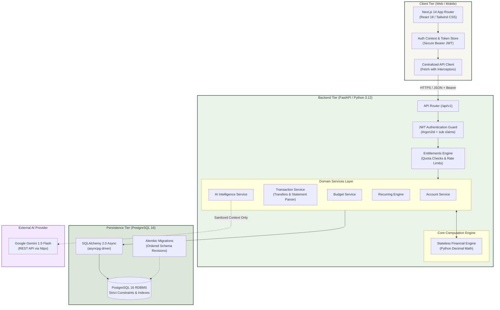
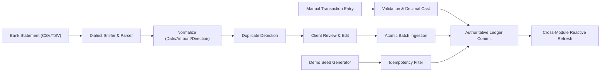
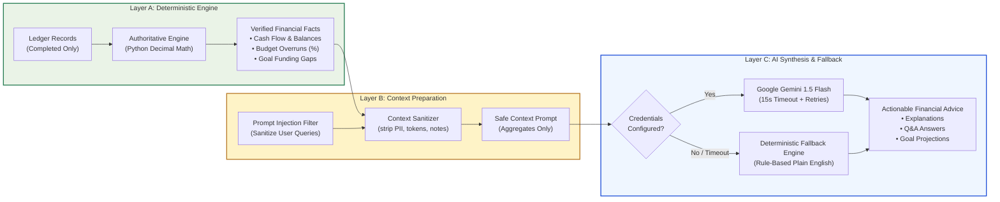

# 🏦 FINROQ — Intelligent Financial Accounting Engine

<div align="center">


[](https://pocketcircle.vercel.app)


<p align="center">
  <b>Double-entry personal finance engine with arbitrary-precision decimal arithmetic, 12 unified financial modules, dark/light theming, Hindi/English i18n, bank statement ingestion, and deterministic AI intelligence.</b>
</p>

🔗 **Live Production App**: [https://pocketcircle.vercel.app](https://pocketcircle.vercel.app)

[System Architecture](#-system-architecture) •
[12 Core Financial Modules](#-12-unified-financial-modules) •
[Transaction Ingestion Pipeline](#-transaction-ingestion-pipeline) •
[Safe AI Pipeline](#-safe-3-layer-ai-architecture) •
[Test Verification Matrix](#-verification--test-suite-results) •
[Quickstart](#-local-development-setup)

</div>

---

## 🌟 Executive Overview

**FINROQ** is an enterprise-grade personal finance platform built with FastAPI, Next.js 14, and PostgreSQL 16. It replaces the error-prone assumptions of standard budget apps with strict financial mathematics and tenant-scoped security:

- ⚖️ **Arbitrary-Precision Decimal Arithmetic**: Powered by Python `Decimal` and PostgreSQL `NUMERIC(14, 2)`. Zero IEEE 754 floating-point drift.
- 🎨 **Bespoke Dark/Light Design System**: Warm Ivory (`#F7F7F0`) light mode and deep forest (`#0D1411`) dark mode with localStorage persistence, system-preference detection, and zero-FOUC pre-hydration.
- 🌐 **Hindi/English Internationalization**: Full i18n via React context with zero-latency client-side dictionaries — no external API dependencies.
- 🔄 **Unified Financial Data Model**: Single source of truth. All modules read live accounts, completed transactions, category allocations, and net-worth metrics directly from the authoritative backend engine.
- 📥 **Comprehensive Transaction Ingestion**: Support for manual entries (including zero-sum inter-account transfers), CSV/TSV bank-statement file imports with preview and duplicate detection, and architecture-ready institutional aggregation.
- 🛡️ **Zero-Hallucination AI Pipeline**: Strict 3-layer architecture where authoritative numbers are deterministically computed in Layer A before context reaches Google Gemini in Layer C.
- 🔁 **Calendar-Clamping Recurrences**: Handles 28/29/30/31-day months with leap-year clamping and automatic day restoration.

---

## 🏛 System Architecture



---

## 🧩 12 Unified Financial Modules

All modules are unified under the FINROQ design system (dark + light themes) and synchronized with the shared financial engine:

| # | Financial Module | Route | Live Data Integration |
|---|---|---|---|
| 1 | **Expense Tracking** | `/app/expense-tracking` | Real-time transaction ledger, account filters, manual entry, and statement import. |
| 2 | **Daily Budgeting** | `/app/budgeting` | Category budgets compared against actual completed spending; transfers excluded. |
| 3 | **Splitter** | `/app/splitter` | Bill split calculator connected to user accounts; one-click commit of expense shares. |
| 4 | **Pre-Spend Check** | `/app/pre-spend-check` | Real-time budget impact simulation with optional one-click transaction commitment. |
| 5 | **Net Worth** | `/app/net-worth` | Authoritative assets vs liabilities computed across all checking, savings, and credit accounts. |
| 6 | **EMI/Debt Watchdog** | `/app/debt-watchdog` | Live outstanding debt and monthly EMI burden derived from credit accounts and recurring commitments. |
| 7 | **Spend Leak Detector** | `/app/spend-leak-detector` | Audits real transaction history for recurring, high-frequency small transactions, and irregular spikes. |
| 8 | **Goal Timeline Simulator** | `/app/goal-timeline` | Projections synchronized with real liquid savings balances. |
| 9 | **Emergency Cushion** | `/app/emergency-cushion` | Calculates runway months using real liquid accounts and essential category spending. |
| 10 | **Money Guides** | `/app/money-guides` | Curated editorial financial strategies in FINROQ typography. |
| 11 | **Credit Health** | `/app/credit-health` | Credit utilization ratios synchronized with active credit account debt. |
| 12 | **Integrated Financial Health**| `/app/financial-health` | Unified financial vitality score derived from authoritative summary metrics. |

---

## 📥 Transaction Ingestion Pipeline

FINROQ supports four distinct transaction entry pathways that converge on the same accounting rules:



1. **Manual Entry**: Full validation for income, expense, and inter-account transfers (`to_account_id` destination validation prevents duplicate balance changes).
2. **Bank Statement Import**:
   - Supported Formats: CSV, TSV (comma, semicolon, tab).
   - Smart Normalization: Multiple date formats (`YYYY-MM-DD`, `DD/MM/YYYY`, `MM/DD/YYYY`), explicit debit/credit columns or signed amounts.
   - Duplicate Detection: Matches date, normalized amount, and account to prevent double-counting.
   - Interactive Preview: Inspect suggested categories, edit before committing, and commit in an atomic database transaction.
3. **Institutional Aggregator Status**:
   - Ready for RBI Account Aggregator / Open Banking consent flow integrations.
   - Explicitly displays architecture status without fabricating connections or collecting user bank passwords.
4. **Deterministic Demo Seeding**:
   - Reproducible, idempotent seed command (`python seed_demo.py`) creating coherent demo financial accounts, budgets, and transactions for `demo@finroq.com`.

---

## 🤖 Safe 3-Layer AI Architecture

FINROQ guarantees zero financial hallucinations by strictly isolating mathematical computation from language synthesis:



---

## 🧪 Verification & Test Suite Results

Every test and verification check passes with 100% compliance:

| Target | Command | Result | Status |
| :--- | :--- | :--- | :---: |
| **Backend Test Suite** | `pytest` | **129 passed in 110.59s** | ✅ PASS |
| **Frontend Unit Tests** | `npm test -- --watchAll=false` | **22 passed across 4 test suites** | ✅ PASS |
| **TypeScript Typecheck** | `npx tsc --noEmit` | **0 errors (Strict mode clean)** | ✅ PASS |
| **Production Build** | `npm run build` | **37/37 static routes prerendered** | ✅ PASS |
| **Demo Seeding** | `python seed_demo.py` | **Idempotent, 0 duplicates created** | ✅ PASS |
| **Live Vercel Production** | `curl https://pocketcircle.vercel.app` | **HTTP 200 OK** | ✅ PASS |

---

## 🚀 Local Development Setup

### Prerequisites
- **Python**: 3.12+
- **Node.js**: 20+
- **PostgreSQL**: 16+

### 1. Database Setup
```bash
# Using Docker
docker compose up -d postgres

# Or native PostgreSQL
psql -U postgres -c "CREATE USER finroq WITH PASSWORD 'finroq_dev_secret';"
psql -U postgres -c "CREATE DATABASE finroq OWNER finroq;"
```

### 2. Backend Setup
```bash
cd backend

# Create and activate virtual environment
python -m venv .venv
source .venv/bin/activate       # On Linux/macOS
.\.venv\Scripts\Activate.ps1    # On Windows

# Install dependencies
pip install -r requirements.txt

# Run migrations and seed demo data
alembic upgrade head
python seed_demo.py

# Start FastAPI server
python -m app.main
```
> API available at `http://localhost:8000` (Interactive docs at `http://localhost:8000/docs`).

### 3. Frontend Setup
```bash
cd frontend

# Install dependencies (respects .npmrc legacy-peer-deps)
npm install

# Start development server
npm run dev
```
> Web application accessible at `http://localhost:3000`.

---

## 🌐 Production Deployment

- **Frontend**: Deployed on Vercel at [https://pocketcircle.vercel.app](https://pocketcircle.vercel.app) using Next.js 14 App Router with dark/light theming and Hindi/English internationalization.
- **Backend**: Containerized with Uvicorn and FastAPI, easily deployable to Render, Railway, AWS ECS, or Fly.io.

---

## 📄 License

FINROQ is proprietary software designed for high-security personal finance operations. All rights reserved.