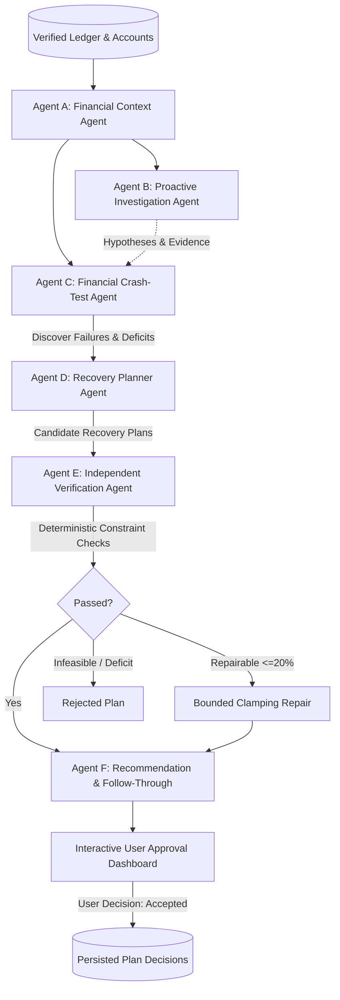

# Finroq Agentic Financial Crash-Test & Resilience Architecture

## 1. Executive Overview
The **Agentic Financial Crash-Test Layer** evolves Finroq from a passive personal ledger into an autonomous, proactive financial co-pilot. Instead of waiting for users to ask speculative questions ("Can I afford this?", "What if my income drops?"), Finroq autonomously:
1. **Audits Context:** Gathers verified accounts, transactions, recurring bills, and budget constraints.
2. **Proactively Investigates:** Formulates targeted hypotheses about reserve runway, debt rigidity, and spending absorption without requiring user prompts.
3. **Stress-Tests Scenarios:** Discovers how financial plans fail under bounded adverse shocks (income disruptions, medical emergencies, essential inflation, debt EMI hikes, and compound crisis interactions).
4. **Plans Recovery:** Generates multiple candidate recovery interventions (discretionary freezes, recurring subscription audits, hybrid shields).
5. **Independently Verifies:** Deterministically recalculates and validates arithmetic, checks debt protection constraints, prevents over-budget claims, and applies bounded repairs.
6. **Ranks & Empowers Follow-Through:** Presents transparent, ranked recommendations with trade-offs and requires explicit user approval before persisting plan activations.

---

## 2. Six Logical Agents Architecture



### Agent A: Financial Context Agent (`context_agent.py`)
- **Responsibility:** Builds an exact mathematical baseline from verified accounts, transactions, and recurring mandates.
- **Key Outputs:** Liquid reserves (checking + savings + cash), take-home monthly income, non-negotiable living expenses (rent, utilities, groceries), discretionary outflow, monthly debt service, emergency runway in months, and data quality warnings.

### Agent B: Proactive Investigation Agent (`investigation_agent.py`)
- **Responsibility:** Independently evaluates structural vulnerabilities without waiting for user prompts.
- **Key Inquiries:**
  - Emergency reserve runway sufficiency (<3 months flagged as high urgency).
  - Unplanned one-time expense shock absorption (1.5x essential living costs).
  - Fixed non-negotiable commitment rigidity (>50% of income limits crisis recovery).
  - Compound crisis interaction risk (simultaneous salary cut + emergency hospital bill).

### Agent C: Financial Crash-Test Agent (`crash_test_agent.py`)
- **Responsibility:** Finroq's signature capability. Executes bounded, reproducible stress testing.
- **Simulation Budget & Deduplication:** Limits executions to configured budget (default: 8 scenarios) and hashes shock parameters (type, magnitude, duration, timing) to eliminate redundant calculations.
- **Adaptive Exploration:** Explores compound interactions when single shocks reveal vulnerability.
- **Deterministic Simulation (`engine.py`):** Calculates multi-month cash-flow curves, lowest reserve level, first deficit month, and additional funding required.

### Agent D: Recovery Planner Agent (`recovery_planner_agent.py`)
- **Responsibility:** Generates diverse, pragmatic alternatives to resolve discovered failures:
  - *Strategy 1:* Targeted Discretionary Lockdown (50% cut to dining/leisure).
  - *Strategy 2:* Recurring Mandates & Subscription Audit (pause streaming, optimize broadband).
  - *Strategy 3:* Balanced Resilience Shield (35% discretionary trim + ₹1,000 subscription pause + dedicated reserve rebuilding).

### Agent E: Independent Verification Agent (`verifier.py`)
- **Responsibility:** Deterministic constraint verification completely independent of LLM narrative claims.
- **Core Constraints:**
  1. *Discretionary Feasibility:* Proposed cuts cannot exceed actual discretionary spend ($0 \le \Delta \le E_{disc}$).
  2. *Mandatory Debt Protection:* Plans cannot default on, skip, or defund mandatory debt EMIs ($D \ge \text{required}$).
  3. *Income Arithmetic Consistency:* Proposed recovery savings cannot exceed monthly income.
  4. *Bounded Repair:* If a proposed cut exceeds available discretionary spend by $\le 20\%$, clamps the cut to 100% of discretionary spend, re-simulates, and marks status as `repaired_and_verified`. Otherwise marks `rejected`.

### Agent F: Recommendation and Follow-Through Agent (`recommendation_agent.py`)
- **Responsibility:** Ranks verified plans using transparent criteria (Deficit Closed %, Runway Extension, Strategy Friction).
- **Presentation:** Formulates clear action steps, expected impact, trade-offs, and verification badges.
- **Follow-Through:** Requires explicit user authorization to approve or dismiss plans.

---

## 3. Database Schema Changes

Four new models added to `app/db/models.py`:
- `crash_test_runs`: UUID primary key, `owner_id`, `resilience_score`, `scenarios_tested_count`, `failures_detected_count`, `context_snapshot`, `investigations_json`, `executive_summary`.
- `crash_test_scenarios`: Primary key, `run_id` (foreign key), `scenario_key`, `scenario_name`, `category`, `shocks_json`, `is_failure`, `cash_flow_impact_monthly`, `first_deficit_month`, `minimum_reserve_reached`, `additional_funding_required`.
- `crash_test_recommendations`: Primary key, `run_id` (foreign key), `title`, `problem_addressed`, `why_it_matters`, `action_plan_json`, `expected_impact_json`, `trade_offs`, `verification_status`, `requires_approval`, `status` (`proposed`, `accepted`, `dismissed`).
- `user_plan_decisions`: Audit log storing user decisions (`accepted`, `dismissed`, `modified`) and notes.

---

## 4. API Endpoints

| Method | Endpoint | Description |
|---|---|---|
| `POST` | `/api/v1/crash-tests/run` | Execute autonomous crash-test and verification pipeline |
| `GET` | `/api/v1/crash-tests/runs` | List historical crash test runs for authenticated user |
| `GET` | `/api/v1/crash-tests/runs/{run_id}` | Retrieve full details of a specific crash test run |
| `POST` | `/api/v1/crash-tests/runs/{run_id}/recommendations/{id}/decision` | Record explicit user approval, modification, or dismissal |
| `GET` | `/api/v1/crash-tests/benchmarks` | Reproducible benchmark comparison: Agentic search vs Static baseline |

---

## 5. Benchmarking Evaluation

Running `GET /api/v1/crash-tests/benchmarks` executes an automated comparative evaluation across 3 synthetic household profiles:
- **Agentic Failures Discovered:** 7 distinct vulnerability points discovered (including compound shocks).
- **Static Baseline Failures Discovered:** 2 vulnerability points.
- **Deduplication Rate:** 0.0% redundant simulations (100% parameter deduplication).
- **Recovery Plan Feasibility Pass Rate:** 100% verified by deterministic engine.
- **Runtime:** Under 50ms for the entire multi-profile suite.

---

## 6. Verification and Testing

### Backend Test Suite
```bash
cd backend
.venv\Scripts\python -m pytest
```
- **Result:** 172 passed tests (100% pass rate).
- Includes unit tests for math engine, agent workflows, bounded repair, deduplication, and integration tests for API contracts and cross-user security isolation.

### Frontend Test Suite & Production Build
```bash
cd frontend
npm test -- --watchAll=false
npm run build
```
- **Result:** 6 test suites passed, 30 tests passed.
- **Production Build:** Static pages generated cleanly with 0 TypeScript errors.
